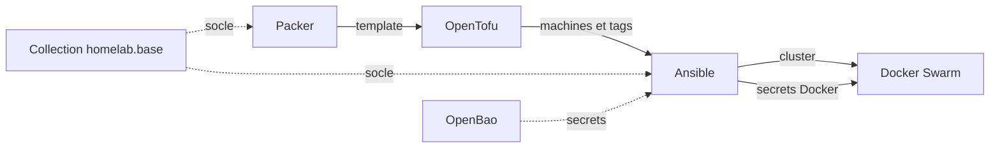

# Configuration de mon homelab avec Ansible

Playbooks et rôles qui configurent les machines de mon homelab : les VM et les
conteneurs LXC de mon cluster Proxmox VE, ainsi qu'un VPS OVH.

C'est le troisième maillon de ma chaîne d'automatisation : Packer construit les
templates, OpenTofu les clone pour créer les machines, Ansible les configure.

## Contenu de ce dépôt

- **Un inventaire sans fichier à maintenir** : il interroge l'API Proxmox, et
  les tags posés par OpenTofu deviennent les groupes Ansible.
- **Du bootstrap au cluster** : socle commun, Docker, stockage partagé
  (GlusterFS, NFS) et cluster Docker Swarm, en un seul point d'entrée.
- **Aucun secret dans le dépôt** : tout est lu dans OpenBao à l'exécution, avec
  un token éphémère limité aux droits d'Ansible.
- **Les sauvegardes vers Proxmox Backup Server** : bases de données
  conteneurisées et forge, chaque nuit.
- **Une CI qui s'héberge elle-même** : le runner Forgejo qui teste ce dépôt est
  installé par ce dépôt.
- **Un socle partagé** : les rôles génériques sont publiés en collection,
  `homelab.base`, que Packer applique aussi au build des templates.

## Architecture

## Mes choix

- **Ansible configure, il ne crée pas** : les machines viennent d'OpenTofu.
  Aucun fichier n'est échangé entre les deux, ajouter une machine à un groupe
  revient à lui poser un tag.
- **Le socle n'est écrit qu'à un seul endroit** : qu'il soit posé dans le
  template par Packer ou au bootstrap, il vient de la même collection.
- **Les secrets sont rangés par propriétaire, pas par lecteur** : le chemin
  d'un secret dans OpenBao dit à quel service il appartient, pour qu'il ne
  change pas quand l'architecture bouge.
- **Le linter voit ce que voit l'exécution** : ansible-lint tourne dans l'image
  d'exécution qui joue les playbooks, avec les mêmes collections.
- **Les actions de CI sont épinglées par empreinte** : une étiquette redéplacée
  ne peut pas changer le contenu d'un job.

## Prochaines étapes

- Terminer la migration des secrets vers la convention `services/<service>`.
- Synchroniser les secrets Docker par convention : découvrir les chemins
  `services/*` au lieu de tenir une liste à la main dans le playbook.

## Organisation

- `site.yml`, `maintenance.yml` : les points d'entrée (bootstrap, mises à jour)
- `playbooks/` : un playbook par usage
- `roles/` : les rôles maison
- `inventory/` : inventaire dynamique, groupes et variables de groupe
- `execution-environment.yml` : l'image d'exécution (ansible-navigator, CI)
- `galaxy.yml` : la collection `homelab.base`

## Pour aller plus loin

- [Utilisation](docs/utilisation.md) : prérequis, commandes, adapter à votre
  environnement
- [Inventaire](docs/inventaire.md) : des tags OpenTofu aux groupes Ansible
- [Secrets](docs/secrets.md) : OpenBao, convention de rangement, clé Harmonia
- [Playbooks et rôles](docs/roles.md) : ce que fait chacun, la collection
- [Intégration continue](docs/ci.md) : runner, workflows

## Licence

[MIT](LICENSE)
